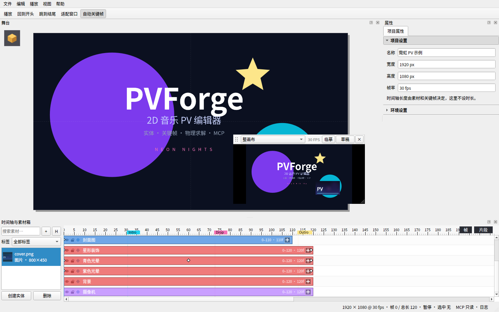
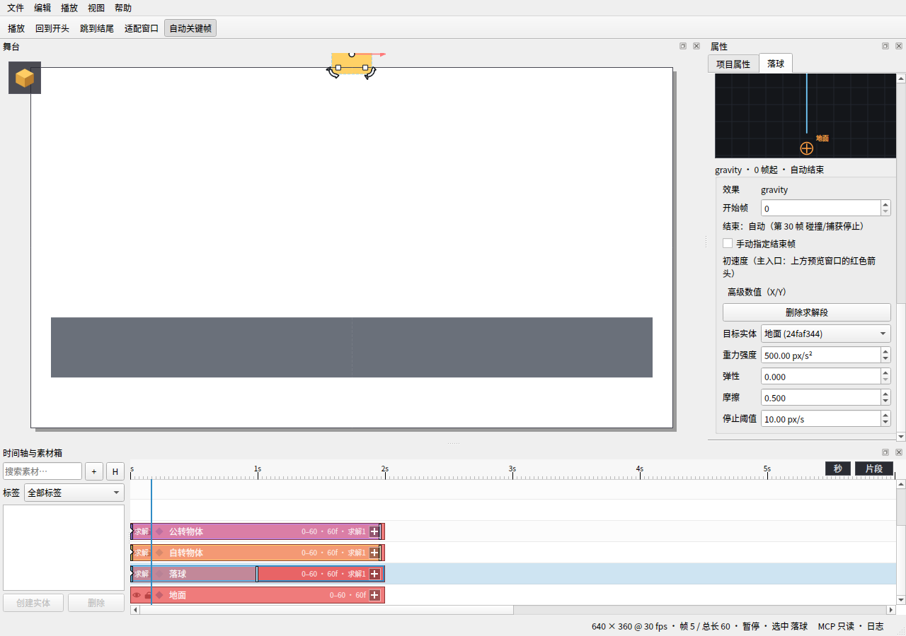
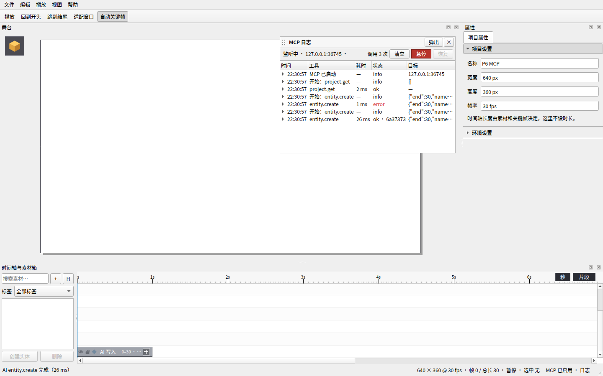

# PVForge

用 Mine-imator 的工作流做 2D 音乐 PV 的桌面编辑器。纯 C++20 + Qt 6，工程是可读的 `.pvproj/` 目录。



## 能做什么

- 实体绑定时间轴片段，逐属性关键帧、贝塞尔缓动
- 图片、视频、音频、文字、矢量、HTML 图层
- 重力、公转、自转、黑洞、螺旋等物理求解
- 摄像机取景、预览缓存、MP4 导出
- 内置 MCP，AI 可以直接读写工程

| 物理求解 | MCP 日志 |
| --- | --- |
|  |  |

## 烂尾代表作

[【永远都在奋斗的三一重工】](https://b23.tv/uC5UpHu)——用 PVForge 第一个有导出功能的版本做的，然后烂尾了。

## 状态

0.4.0 里程碑版，Linux x86_64 优先。项目仍在概念验证阶段，随时可能大改，**不要用于正式项目**。

## 免责声明

这是一个练手性质的概念验证项目，没有正式版，不保证稳定、兼容或数据安全。工程格式和行为随时可能变化，可能导致工程损坏或数据丢失。使用本软件造成的任何直接或间接损失，作者不承担责任。请自行备份。

## 想直接试试

把仓库整个丢给任意 AI 编码工具（Claude Code、Codex、OpenCode 等），让它读 `AGENT.md` 和 `docs/human/`，按 `ci/install-deps.sh` 装依赖、`cmake --preset debug` 构建、`ctest -L self-test` 自检。AI 会自己把环境跑起来。

手动构建：

```bash
ci/install-deps.sh          # 系统依赖
cmake --preset debug        # 需要 Qt 6.5+、FFmpeg 8
cmake --build --preset debug -j 8
./build/debug/pvforge
```

发布包见 [Releases](https://github.com/xmb505/pvforge/releases)。

## 许可

[MIT](LICENSE)
